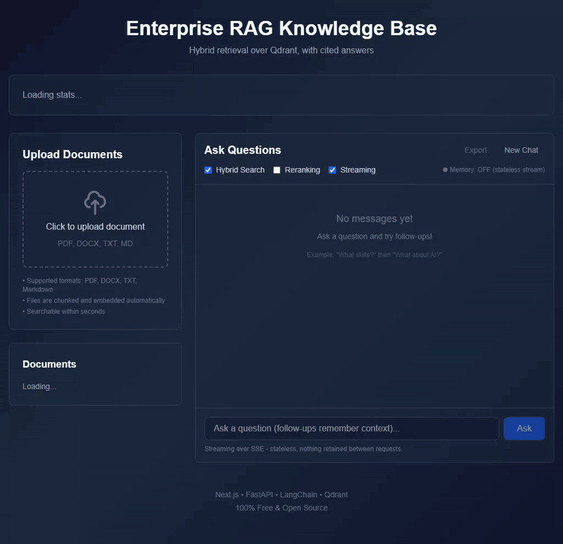
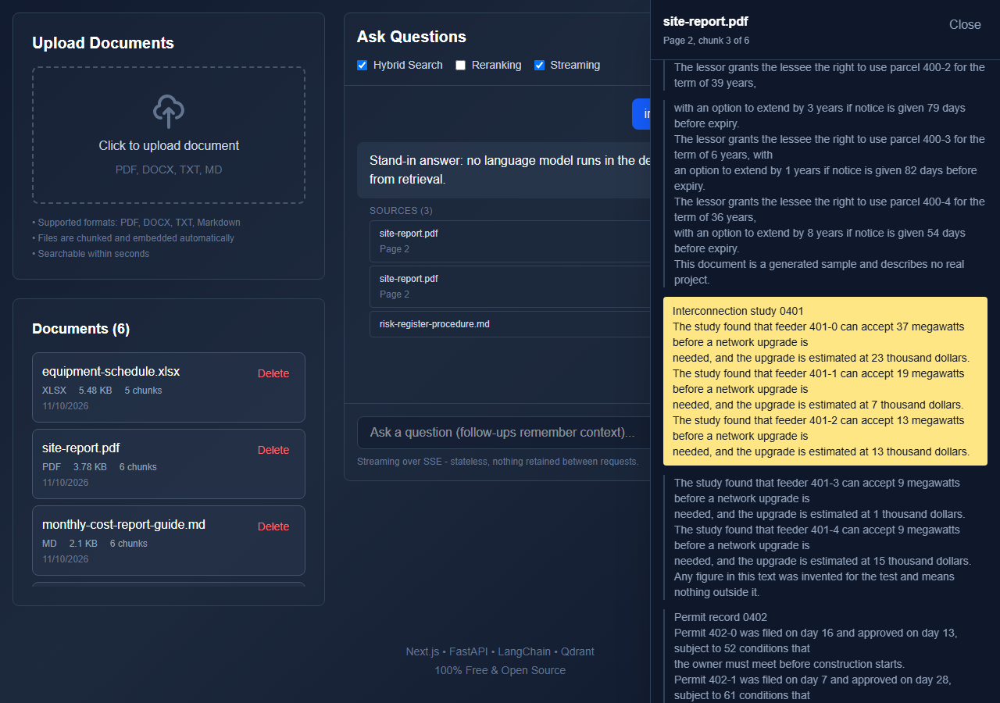

# Enterprise RAG Knowledge Base

[](https://github.com/Exalt24/enterprise-rag-knowledge-base/actions/workflows/ci.yml)

FastAPI RAG service on Qdrant: vector and BM25 hybrid retrieval, SSE streaming and an OpenAI-compatible endpoint. It also ingests zip archives through Hatchet, and each citation opens its exact passage.



*Recorded locally with Qdrant in Docker, qwen3:14b on Ollama and three short handbook samples. Answer stretches run at half speed, marked on screen. More in [docs/reference.md](docs/reference.md#the-recording).*

**Proof:** a retrieval evaluation anyone can rerun in one command, a [read-only MCP server](#mcp-server-read-only-local), an [archive workflow on Hatchet](#archive-ingestion-with-hatchet) and a [source panel](#source-view) run for real, and CI with a mutation check. An older 85% and 90% hit rate (2026-08-03, a corpus no longer in this repo) is kept apart in [docs/engineering-notes.md](docs/engineering-notes.md#retrieval-accuracy).

## What broke

Upload PDF, DOCX, XLSX, TXT or Markdown files and get cited answers (a workbook answer cites sheet and cells, like `Vendors!A2:C3`). I built it to see where a retrieval pipeline fails, so most of this README is about the failures.

- **A scoring bug that inverted the ranking.** `hybrid_search` ran `1 / (1 + score)` on a cosine similarity that was already "higher is better", so a 0.82 match scored 0.549 and a 0.12 match 0.893, and every test stayed green because they only checked that results came back. The fix uses the cosine score directly, `backend/tests/test_hybrid_ranking.py` fails on the old line, and the mutation check puts the bug back and shows a test going red. An earlier accuracy series (about 40, 60 and 67.7 percent) predated the fix and is retracted.
- **A silent fallback.** `hybrid_search` caught every exception and answered with plain vector search, so a broken BM25 branch looked like working hybrid retrieval. The engine now counts fallbacks and the evaluation fails above zero.
- **A deploy that looked like a slow cold start.** The default torch wheel (526.6 MB) got the 512 MB free instance OOM-killed on import. The image now uses fastembed (same weights, ONNX Runtime), and import fell from about two minutes to 1.87 seconds (once, no log).
- **A retired model.** Groq retired the model this service named in seven places. It is now one setting, `GROQ_MODEL`.

Full write-up: [docs/engineering-notes.md](docs/engineering-notes.md).

## Measured results

### Rerunnable evaluation (run on 2026-10-23)

The corpus is four documents in [`backend/eval/corpus/`](backend/eval/corpus/). I wrote them as samples for this repository, about a fictional organisation. They give 27 chunks through the repo's own chunker. The 42 questions in [`backend/eval/questions.jsonl`](backend/eval/questions.jsonl) are 12 direct, 12 paraphrase, 8 multi-document and 10 unanswerable. Each answerable question carries a `must_contain` phrase copied verbatim from the corpus. A retrieved chunk counts only if it holds it.

Everything goes through the repo's own chunker, vector store and retrieval code. Only the embedder is swapped. Wiring, labels, baseline and mutants: [docs/evaluation.md](docs/evaluation.md). Cells show the value and a 95% bootstrap interval over questions. A cell at the ceiling (1.00 to 1.00) has no spread, because every resample hits the same value.

**What a hit means.** On a multi-document question hit@k counts it when any one needed chunk is in the top k. recall@k counts how many of the needed chunks are. Elsewhere a question has one needed chunk. There the two are equal.

Rerun it with `cd backend && pip install -r requirements-ci.txt`, then `python eval/run_eval.py --check` for the first table (deterministic, no download, no network; it fails on a fallback, a chunking change or a regression) and `python eval/run_eval.py --embedder real` for the second. `python eval/mutation_check.py` breaks the guarded code one way at a time.

**Table 1, HARNESS CHECK (hashing embedder).** This embedder has no idea what any word means, so the table shows that the harness and the ranking code run and are pinned, and says nothing about retrieval quality. CI compares it with a fresh run.

| method | category | n | hit@1 | hit@3 | MRR | recall@3 | recall@5 |
|---|---|---|---|---|---|---|---|
| vector | direct | 12 | 0.83 (0.58 to 1.00) | 1.00 (1.00 to 1.00) | 0.92 (0.79 to 1.00) | 1.00 (1.00 to 1.00) | 1.00 (1.00 to 1.00) |
| vector | paraphrase | 12 | 0.50 (0.25 to 0.75) | 0.67 (0.42 to 0.92) | 0.59 (0.35 to 0.83) | 0.67 (0.42 to 0.92) | 0.75 (0.50 to 1.00) |
| vector | multi-document | 8 | 0.88 (0.62 to 1.00) | 1.00 (1.00 to 1.00) | 0.92 (0.75 to 1.00) | 0.88 (0.69 to 1.00) | 1.00 (1.00 to 1.00) |
| bm25 | direct | 12 | 0.75 (0.50 to 1.00) | 1.00 (1.00 to 1.00) | 0.88 (0.75 to 1.00) | 1.00 (1.00 to 1.00) | 1.00 (1.00 to 1.00) |
| bm25 | paraphrase | 12 | 0.42 (0.17 to 0.67) | 0.75 (0.50 to 1.00) | 0.54 (0.31 to 0.76) | 0.75 (0.50 to 1.00) | 0.75 (0.50 to 1.00) |
| bm25 | multi-document | 8 | 0.88 (0.62 to 1.00) | 1.00 (1.00 to 1.00) | 0.92 (0.75 to 1.00) | 0.75 (0.56 to 0.94) | 0.81 (0.62 to 1.00) |
| hybrid | direct | 12 | 0.83 (0.58 to 1.00) | 1.00 (1.00 to 1.00) | 0.92 (0.79 to 1.00) | 1.00 (1.00 to 1.00) | 1.00 (1.00 to 1.00) |
| hybrid | paraphrase | 12 | 0.50 (0.25 to 0.75) | 0.75 (0.50 to 1.00) | 0.58 (0.33 to 0.83) | 0.75 (0.50 to 1.00) | 0.75 (0.50 to 1.00) |
| hybrid | multi-document | 8 | 0.88 (0.62 to 1.00) | 1.00 (1.00 to 1.00) | 0.92 (0.75 to 1.00) | 0.88 (0.75 to 1.00) | 0.94 (0.81 to 1.00) |
| chance | direct |  | 0.04 | 0.11 | 0.08 | 0.11 | 0.19 |
| chance | paraphrase |  | 0.04 | 0.11 | 0.08 | 0.11 | 0.19 |
| chance | multi-document |  | 0.07 | 0.21 | 0.16 | 0.11 | 0.19 |

Hybrid fallbacks in this run: 0.

**Table 2, real model (local run on 2026-10-23).** The embedding model is the repo's default, all-MiniLM-L6-v2 through `HuggingFaceEmbeddings` (torch 2.14.1 CPU, Python 3.13). The fastembed ONNX path printed the same numbers. CI does not repeat this run.

| method | category | n | hit@1 | hit@3 | MRR | recall@3 | recall@5 |
|---|---|---|---|---|---|---|---|
| vector | direct | 12 | 0.92 (0.75 to 1.00) | 1.00 (1.00 to 1.00) | 0.96 (0.88 to 1.00) | 1.00 (1.00 to 1.00) | 1.00 (1.00 to 1.00) |
| vector | paraphrase | 12 | 0.67 (0.42 to 0.92) | 0.83 (0.58 to 1.00) | 0.72 (0.47 to 0.94) | 0.83 (0.58 to 1.00) | 0.83 (0.58 to 1.00) |
| vector | multi-document | 8 | 0.62 (0.25 to 0.88) | 1.00 (1.00 to 1.00) | 0.77 (0.54 to 1.00) | 0.69 (0.50 to 0.88) | 0.69 (0.56 to 0.88) |
| bm25 | direct | 12 | 0.75 (0.50 to 1.00) | 1.00 (1.00 to 1.00) | 0.88 (0.75 to 1.00) | 1.00 (1.00 to 1.00) | 1.00 (1.00 to 1.00) |
| bm25 | paraphrase | 12 | 0.42 (0.17 to 0.67) | 0.75 (0.50 to 1.00) | 0.54 (0.31 to 0.76) | 0.75 (0.50 to 1.00) | 0.75 (0.50 to 1.00) |
| bm25 | multi-document | 8 | 0.88 (0.62 to 1.00) | 1.00 (1.00 to 1.00) | 0.92 (0.75 to 1.00) | 0.75 (0.56 to 0.94) | 0.81 (0.62 to 1.00) |
| hybrid | direct | 12 | 0.92 (0.75 to 1.00) | 1.00 (1.00 to 1.00) | 0.96 (0.88 to 1.00) | 1.00 (1.00 to 1.00) | 1.00 (1.00 to 1.00) |
| hybrid | paraphrase | 12 | 0.58 (0.25 to 0.83) | 0.83 (0.58 to 1.00) | 0.72 (0.52 to 0.92) | 0.83 (0.58 to 1.00) | 0.92 (0.75 to 1.00) |
| hybrid | multi-document | 8 | 0.62 (0.25 to 0.88) | 1.00 (1.00 to 1.00) | 0.77 (0.56 to 0.94) | 0.69 (0.56 to 0.88) | 0.88 (0.69 to 1.00) |

What it says: every method beats the chance rows by a wide margin. Hybrid did not beat vector on this set: on hit@1 they are equal on direct and multi-document questions, hybrid is lower on paraphrase, and every interval overlaps, so there is no direction to report. On the multi-document questions, hit@3 is 1.00 for all three methods in both tables. With the real model (2026-10-23), recall@3 is 0.69 for vector, 0.75 for BM25 and 0.69 for hybrid. A hit there often means one of the needed chunks and not all of them.

**Unanswerable questions.** The evaluation defines abstention: it declines when the best chunk's score is below a threshold calibrated on a separate 16-question set (`backend/eval/calibration.jsonl`). With the real model (2026-10-23), 5 of the 10 unanswerable questions were declined (0.50, interval 0.20 to 0.80). 84% (vector) and 75% (hybrid) of the answerable ones were kept. That is weak: it wrongly declines paraphrase questions.

## Archive ingestion with Hatchet

A data room arrives as one zip. `ingest_archive` runs on [Hatchet](https://docs.hatchet.run) (Python SDK 1.45.1, self-hosted `hatchet-lite`, no cloud account): it checks the zip, then starts one run per file that parses, chunks, embeds and upserts it with this repo's own loader, chunker and vector store. The same bytes are never indexed twice, a bad file is recorded without stopping the rest, and only an outage is retried. `POST /api/ingest/archive` starts it and `GET /api/ingest/{run_id}` returns the result table. Rules, guards and tests: [docs/ingestion.md](docs/ingestion.md).

```bash
docker compose -f docker-compose.hatchet.yml up -d --wait postgres hatchet-lite qdrant
export HATCHET_CLIENT_TOKEN=$(docker compose -f docker-compose.hatchet.yml exec -T hatchet-lite /hatchet-admin token create --config /config --tenant-id 707d0855-80ab-4e1f-a156-f1c4546cbf52)
docker compose -f docker-compose.hatchet.yml --profile worker up -d --build worker
python backend/eval/archive_fixture.py ingest-data/room.zip --files 300
docker compose -f docker-compose.hatchet.yml --profile worker run --rm worker python -m app.workflows run /data/room.zip
```

**Measured on 2026-11-10**, one worker, a laptop class CPU, the repo's fastembed model, archives from `eval/archive_fixture.py` (invented text). Seconds run from the start of the zip check to the last file.

| run | files | result | seconds |
|---|---|---|---|
| mixed files (txt, md, pdf, docx, xlsx), first run | 300 | 293 ingested (919 chunks), 2 exact copies skipped, 5 failed with a reason | 39.9 |
| the same archive again | 300 | nothing written, 295 skipped, the same 5 fail again | 6.3 |
| small generated text files | 3000 | 3000 ingested (4125 chunks), 0 failed | 481.4 |

The mixed archive holds a corrupt PDF, a password protected PDF, a fake workbook, a nested zip and a `.png`. Each failed with its own reason and every other file was stored. From submit to done the runs took 42.8, 9.1 and 484 seconds, since a run also waits to be scheduled. The rerun parsed only the three unreadable files again.

**Limits:** not production. hatchet-lite is Hatchet's development image, this is one worker on one machine, and the API and worker share a spool folder. The SDK's worker needs POSIX, so on Windows it runs in Docker. Once a task sat queued for about four minutes until another run woke the scheduler (lite v0.114.2); I did not find why.

## Source view

Each citation opens a side panel with the cited passage in its document: the text highlighted, the chunks above and below it, the document name and the place (a PDF page, which the loader already keeps, the sheet and cells of a workbook, or a chunk number). `GET /api/documents/{doc_id}/chunks/{chunk_id}?context=2` serves it. A Playwright test clicks a citation on the demo corpus and checks that the highlighted text is the cited chunk.



**Limits:** chunks stored before this change have no ids and are not clickable until re-uploaded. The highlight is the whole chunk. Text only, no page image, no sign-in. More: [docs/source-view.md](docs/source-view.md).

## MCP server (read-only, local)

**Use case:** a Claude Code or other MCP client asks this knowledge base questions and gets cited answers through three read-only tools (`search_documents`, `ask_question`, `list_documents`), served by [`backend/mcp_server/server.py`](backend/mcp_server/server.py) over stdio on the official Python SDK (Python 3.11 or newer). Register it with `claude mcp add enterprise-rag -e QDRANT_URL=http://localhost:6333 -- python /abs/backend/mcp_server/server.py`. Tools, `--demo-corpus` (no Qdrant, no model) and errors: [docs/mcp-server.md](docs/mcp-server.md).

**Limits:** local stdio only, read-only, not deployed, no rate limiting, never run in Claude Desktop or Claude Code (I used the SDK's client and raw JSON-RPC). Citations are the chunks the model was given, not proof of support, and retrieved text may carry an instruction the client must treat as untrusted.

## Architecture and more

The diagram and the flows are in [docs/SYSTEM-KNOWLEDGE.md](docs/SYSTEM-KNOWLEDGE.md#the-shape-of-the-system). Hybrid retrieval (the default) adds a flat 0.15 bonus to any chunk BM25 also returns, so BM25 is a keyword-agreement bonus, not a normalised score. Also here: an [Agent Skill](skills/querying-knowledge-base/SKILL.md) for the MCP tools ([details](docs/evaluation.md#agent-skill)) and a Vertex AI Gemini provider **built and tested against a stand-in server** ([details](docs/vertex-provider.md)). More: [docs/reference.md](docs/reference.md).

## Run it

You need Docker, Python 3.13+, Node 20.9+ and Ollama with one model pulled, and no account or key. [docs/reference.md](docs/reference.md#quick-start) has the steps for Qdrant, the backend (port 8001) and the front end, then API examples, Groq and deployment. The first start downloads all-MiniLM-L6-v2, and the recording used `qwen3:14b` ([how to match it](docs/reference.md#the-recording)).

## Tests

```bash
cd backend && pip install -r requirements-ci.txt -r requirements-mcp.txt
python -m pytest tests/test_hybrid_ranking.py     # stubbed modules, so run it alone
python -m pytest tests/test_eval_*.py             # the shell expands the glob
python -m pytest tests/test_mcp_server*.py tests/test_skill_*.py
```

None of these needs a running service, a model download, a key or a network. More: [ingestion.md](docs/ingestion.md#tests), [source-view.md](docs/source-view.md#tests), [evaluation.md](docs/evaluation.md#running-the-tests).

## Next steps

- The corpus is small and the questions were written from it, so this is a regression check that pins behaviour. A larger corpus comes first, then comparing hybrid against vector and measuring reranking.
- BM25 needs lowercasing, punctuation stripping and no result when no term matches ([detail](docs/evaluation.md#known-limits-of-the-retrieval-code)).

## Stack

Python 3.13, FastAPI, LangChain, LangGraph, Qdrant, Redis, fastembed or sentence-transformers (all-MiniLM-L6-v2), rank-bm25, Groq, Ollama, Vertex AI, Next.js 16, React 19, TypeScript, Tailwind CSS.

## License

MIT, see [LICENSE](LICENSE). By Daniel Alexis Cruz, [dacruz.vercel.app](https://dacruz.vercel.app).
