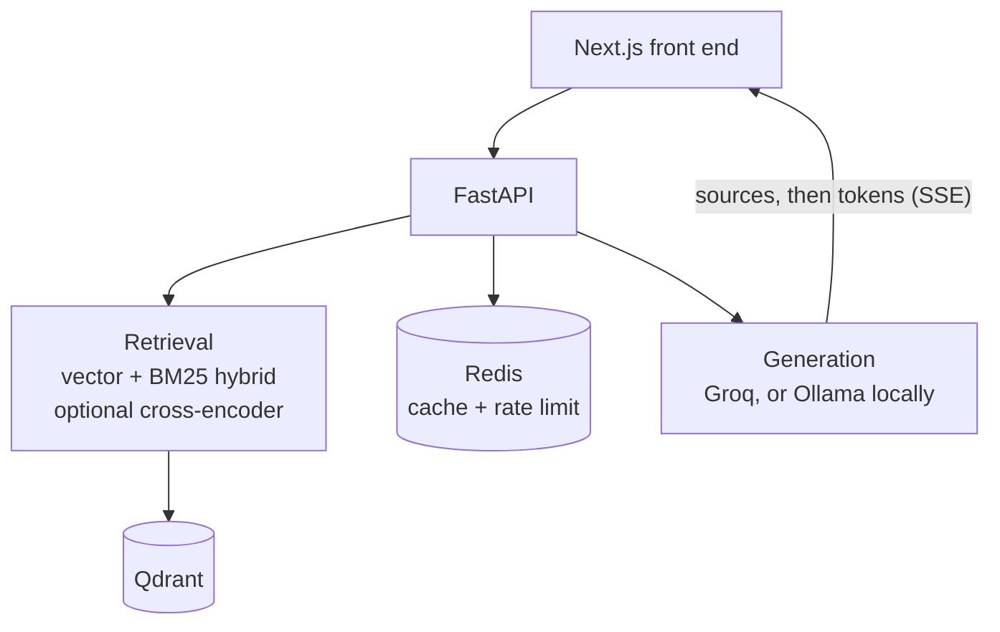

# Enterprise RAG Knowledge Base

[](https://github.com/Exalt24/enterprise-rag-knowledge-base/actions/workflows/ci.yml)

FastAPI RAG service on Qdrant: vector and BM25 hybrid retrieval, SSE streaming and an OpenAI-compatible endpoint.


*Recorded on a local stack: Qdrant in Docker, this repo's backend and front end, and qwen3:14b served by Ollama. Three short made-up handbook files, about 14 chunks. The two answer stretches are shown at half speed, marked on screen. Sources are listed per chunk, so one file can appear twice in a citation list, and the dates in the document list read month/day/year.*

**Proof:** a retrieval evaluation anyone can rerun in one command (4 invented documents, 42 labelled questions, a pinned baseline, results below), and CI that runs the tests plus a mutation check. The older 85% and 90% figures are kept apart, further down, as a record of a corpus that is no longer in this repo.

The hosted copy is offline: the free-tier host suspended its services in October 2026. It runs locally in a few commands below.

## What it is and why

Upload documents (PDF, DOCX, TXT, Markdown), ask questions, get answers with citations. The backend is FastAPI and LangChain over Qdrant, the front end is Next.js. I built it to see where a retrieval pipeline actually fails, so most of this README is about the failures.

## What broke

- **A scoring bug that inverted the ranking.** `hybrid_search` applied `1 / (1 + score)` to a cosine similarity that was already "higher is better", so a 0.82 match scored 0.549 and a 0.12 match scored 0.893. Every test stayed green because they only checked that results came back. The fix uses the cosine score directly, and `backend/tests/test_hybrid_ranking.py` now fails on the original line. The mutation check puts that bug back and shows a test going red. I retracted an earlier accuracy series (about 40, 60 and 67.7 percent) because it predated the fix and was never re-measured.
- **A silent fallback.** `hybrid_search` catches every exception and answers with plain vector search, so a broken BM25 branch looked exactly like working hybrid retrieval. The engine now counts its fallbacks and the evaluation fails when the count is above zero.
- **A deploy that looked like a slow cold start.** The 512 MB free instance was OOM-killed on import because the default Linux torch wheel is 526.6 MB. The fix was to drop torch from the deployed image: fastembed runs the same all-MiniLM-L6-v2 weights through ONNX Runtime, so the vectors already in Qdrant stayed valid. Measured under a real 512 MB cap: import time about two minutes down to 1.87 seconds, peak memory 438 MiB down to 259 MiB.
- **A retired model.** Groq retired the model this service named in seven places. The key stayed valid and the client still built, so calls failed while the health endpoint said the vector database was connected. The model is now one setting, `GROQ_MODEL`.

The full write-up, including the design decisions, is in [docs/engineering-notes.md](docs/engineering-notes.md).

## Measured results

### Rerunnable evaluation (run on 2026-10-23)

The corpus is **synthetic**: four documents invented for this repository (a risk register procedure, a change control procedure, a monthly cost report guide and a lessons learned note on an invented project), in [`backend/eval/corpus/`](backend/eval/corpus/). They describe no real organisation and claim no domain experience. They give 27 chunks through the repo's own chunker. The 42 questions in [`backend/eval/questions.jsonl`](backend/eval/questions.jsonl) are 12 direct, 12 paraphrase, 8 multi-document and 10 unanswerable. Each answerable question carries a `must_contain` phrase copied verbatim from the corpus, and a retrieved chunk counts only if it holds that phrase. A test proves each phrase sits in exactly the document the question names.

Everything goes through the repo's own code (its chunker, its real `VectorStoreService` on `QdrantClient(":memory:")`, `retrieval_service`, `AdvancedRetrieval`); only the embedder is swapped. [docs/evaluation.md](docs/evaluation.md) has the wiring, the labelling rules, the baseline and the mutants. Cells show the value and a 95% bootstrap interval over questions. With 8 to 12 questions per category the intervals are wide, and the chance rows show what a random ranking of the same 27 chunks scores. A cell at the ceiling (1.00 to 1.00) has no spread because every resample of the questions hits the same value; it means the method found it every time on these questions, not that it would on others.

**What a hit means.** A multi-document question needs chunks from two documents. hit@k counts it when any one needed chunk is in the top k; recall@k counts how many of the needed chunks are. So a hit@3 of 1.00 on a multi-document row says every question had at least one of its chunks in the top 3, and the recall columns say how much of what it needed was found. For the other categories a question has one needed chunk, so hit and recall are the same number.

```bash
cd backend && pip install -r requirements-ci.txt
python eval/run_eval.py                     # table 1: deterministic, no download, no network
python eval/run_eval.py --check             # same run, then fail on a fallback, a chunking change or a regression
python eval/run_eval.py --embedder real     # table 2: the repo's own embedding model, run locally
python eval/run_eval.py --markdown t.md     # the results table below, written from the run (no number typed by hand)
python eval/mutation_check.py               # break the guarded code one way at a time, require a failing test each time
```

**Table 1, HARNESS CHECK (hashing embedder).** This embedder hashes words into a vector and has no idea what any of them mean, so the table shows that the harness and the ranking code run and are pinned. No quality claim and no "hybrid beats vector" claim comes from it. `eval/baseline.json` pins its chunk count, a hash of the chunk texts, a hash of each question file and these numbers.

| method | category | n | hit@1 | hit@3 | MRR | recall@3 | recall@5 |
|---|---|---|---|---|---|---|---|
| vector | direct | 12 | 0.83 (0.58 to 1.00) | 1.00 (1.00 to 1.00) | 0.92 (0.79 to 1.00) | 1.00 (1.00 to 1.00) | 1.00 (1.00 to 1.00) |
| vector | paraphrase | 12 | 0.50 (0.25 to 0.75) | 0.67 (0.42 to 0.92) | 0.59 (0.35 to 0.83) | 0.67 (0.42 to 0.92) | 0.75 (0.50 to 1.00) |
| vector | multi-document | 8 | 0.88 (0.62 to 1.00) | 1.00 (1.00 to 1.00) | 0.92 (0.75 to 1.00) | 0.88 (0.69 to 1.00) | 1.00 (1.00 to 1.00) |
| bm25 | direct | 12 | 0.75 (0.50 to 1.00) | 1.00 (1.00 to 1.00) | 0.88 (0.75 to 1.00) | 1.00 (1.00 to 1.00) | 1.00 (1.00 to 1.00) |
| bm25 | paraphrase | 12 | 0.42 (0.17 to 0.67) | 0.75 (0.50 to 1.00) | 0.54 (0.31 to 0.76) | 0.75 (0.50 to 1.00) | 0.75 (0.50 to 1.00) |
| bm25 | multi-document | 8 | 0.88 (0.62 to 1.00) | 1.00 (1.00 to 1.00) | 0.92 (0.75 to 1.00) | 0.75 (0.56 to 0.94) | 0.81 (0.62 to 1.00) |
| hybrid | direct | 12 | 0.83 (0.58 to 1.00) | 1.00 (1.00 to 1.00) | 0.92 (0.79 to 1.00) | 1.00 (1.00 to 1.00) | 1.00 (1.00 to 1.00) |
| hybrid | paraphrase | 12 | 0.50 (0.25 to 0.75) | 0.75 (0.50 to 1.00) | 0.58 (0.33 to 0.83) | 0.75 (0.50 to 1.00) | 0.75 (0.50 to 1.00) |
| hybrid | multi-document | 8 | 0.88 (0.62 to 1.00) | 1.00 (1.00 to 1.00) | 0.92 (0.75 to 1.00) | 0.88 (0.75 to 1.00) | 0.94 (0.81 to 1.00) |
| chance | direct |  | 0.04 | 0.11 | 0.08 | 0.11 | 0.19 |
| chance | paraphrase |  | 0.04 | 0.11 | 0.08 | 0.11 | 0.19 |
| chance | multi-document |  | 0.07 | 0.21 | 0.16 | 0.11 | 0.19 |

Hybrid fallbacks in this run: 0.

**Table 2, real model (local run, same day).** The embedding model is the repo's default, all-MiniLM-L6-v2 through `HuggingFaceEmbeddings` (torch 2.14.1 CPU, sentence-transformers 6.2.0, Python 3.13). The fastembed ONNX path printed the same numbers. CI does not repeat this run.

| method | category | n | hit@1 | hit@3 | MRR | recall@3 | recall@5 |
|---|---|---|---|---|---|---|---|
| vector | direct | 12 | 0.92 (0.75 to 1.00) | 1.00 (1.00 to 1.00) | 0.96 (0.88 to 1.00) | 1.00 (1.00 to 1.00) | 1.00 (1.00 to 1.00) |
| vector | paraphrase | 12 | 0.67 (0.42 to 0.92) | 0.83 (0.58 to 1.00) | 0.72 (0.47 to 0.94) | 0.83 (0.58 to 1.00) | 0.83 (0.58 to 1.00) |
| vector | multi-document | 8 | 0.62 (0.25 to 0.88) | 1.00 (1.00 to 1.00) | 0.77 (0.54 to 1.00) | 0.69 (0.50 to 0.88) | 0.69 (0.56 to 0.88) |
| bm25 | direct | 12 | 0.75 (0.50 to 1.00) | 1.00 (1.00 to 1.00) | 0.88 (0.75 to 1.00) | 1.00 (1.00 to 1.00) | 1.00 (1.00 to 1.00) |
| bm25 | paraphrase | 12 | 0.42 (0.17 to 0.67) | 0.75 (0.50 to 1.00) | 0.54 (0.31 to 0.76) | 0.75 (0.50 to 1.00) | 0.75 (0.50 to 1.00) |
| bm25 | multi-document | 8 | 0.88 (0.62 to 1.00) | 1.00 (1.00 to 1.00) | 0.92 (0.75 to 1.00) | 0.75 (0.56 to 0.94) | 0.81 (0.62 to 1.00) |
| hybrid | direct | 12 | 0.92 (0.75 to 1.00) | 1.00 (1.00 to 1.00) | 0.96 (0.88 to 1.00) | 1.00 (1.00 to 1.00) | 1.00 (1.00 to 1.00) |
| hybrid | paraphrase | 12 | 0.58 (0.25 to 0.83) | 0.83 (0.58 to 1.00) | 0.72 (0.52 to 0.92) | 0.83 (0.58 to 1.00) | 0.92 (0.75 to 1.00) |
| hybrid | multi-document | 8 | 0.62 (0.25 to 0.88) | 1.00 (1.00 to 1.00) | 0.77 (0.56 to 0.94) | 0.69 (0.56 to 0.88) | 0.88 (0.69 to 1.00) |

What it says: every method beats the chance rows by a wide margin. Hybrid did not beat vector on this set (hit@1 is equal on direct and multi-document questions and lower on paraphrase, every interval overlapping), so there is no direction to report. On the multi-document questions hit@3 is 1.00 for all three methods in both tables, but with the real model recall@3 is 0.69 for vector, 0.75 for BM25 and 0.69 for hybrid, so a hit there often means one of the needed chunks and not all of them.

**Unanswerable questions.** The retrieval code has no abstention, so the evaluation defines one: decline when the best chunk's score is below a threshold calibrated on a separate 16-question set ([`backend/eval/calibration.jsonl`](backend/eval/calibration.jsonl)), printed with each run. With the real model 5 of the 10 unanswerable questions were declined (0.50, interval 0.20 to 0.80) while 84% (vector) and 75% (hybrid) of the answerable ones were kept. That is weak, and it wrongly declines paraphrase questions.

**CI.** The `python-backend` job runs the tests, `--check` and the mutation check on every push. First run on a cold pip cache: install 31 seconds, whole job 146 seconds, against a 15 minute timeout (run 39863561524, read from the job log). The steps are in [docs/evaluation.md](docs/evaluation.md).

### Record of the earlier 20-question eval (2026-08-03, not reproducible here)

20 questions over a 26-chunk corpus, run on 2026-08-03 against the then-live deployment with `backend/tests/eval_retrieval.py`. That corpus is not in this repo and cannot be recovered, so these figures are a record of that run and are **not** comparable with the tables above, which measure a different corpus and different questions.

| hit@k | vector only | hybrid |
|---|---|---|
| k=1 | 85.0% | 90.0% |
| k=3 | 100% | 100% |

Hybrid beat vector by one question of twenty: a direction, not a result. A cached repeat of a query took 0.28 seconds against 2.7 for the first call (curl from my machine, 2026-10-07, network included). Reranking is not measured.

## Architecture



Hybrid retrieval (the default) scores the top 2k vector hits at cosine times 0.7 and adds a flat 0.15 to any chunk BM25 also returns, so BM25 is a keyword-agreement bonus, not a normalised score. Other endpoints: `POST /api/query/stream` (citations arrive before the first token) and `POST /api/v1/chat/completions` (repoint an OpenAI client's `base_url`).

## Run it

You need Docker, Python 3.13+, Node 18+ and Ollama with one model pulled. The local path needs no account and no API key; a Groq key is only for the cloud setup in [docs/reference.md](docs/reference.md). `pip install` pulls torch and the first backend start downloads the all-MiniLM-L6-v2 embedding model, so allow a few minutes.

The commands use the code's default model, `llama3`. The recording used `qwen3:14b`: to match it, pull that model and set `OLLAMA_MODEL=qwen3:14b`, `OLLAMA_REASONING=false` and `OLLAMA_TIMEOUT=300` before starting the backend (step 2 of the reference). Answers from `llama3` will read differently.

```bash
docker run -d --name rag-qdrant -p 6333:6333 qdrant/qdrant && ollama pull llama3
cd backend && python -m venv venv && source venv/bin/activate && pip install -r requirements.txt   # Windows Git Bash: venv/Scripts/activate
QDRANT_URL=http://localhost:6333 python -m app.main            # http://localhost:8001, docs at /docs
cd ../frontend && npm install && echo "NEXT_PUBLIC_API_URL=http://localhost:8001/api" > .env.local && npm run dev
```

Sample documents are in [`docs/sample-corpus/`](docs/sample-corpus/). Full steps, API examples, environment variables and deployment are in [docs/reference.md](docs/reference.md).

## Tests

```bash
cd backend && pip install -r requirements-ci.txt
python -m pytest tests/test_hybrid_ranking.py        # the ranking regression test, stubbed modules
python -m pytest tests/test_eval_fallback_counter.py tests/test_eval_fallback_cause.py tests/test_eval_labels.py \
    tests/test_eval_questions.py tests/test_eval_harness.py tests/test_eval_baseline.py \
    tests/test_eval_baseline_changes.py tests/test_eval_readme_claims.py tests/test_eval_mutation_targets.py
```

None of these needs a running service, a model download or a network. Run the two commands separately, as CI does. `backend/pytest.ini` skips what cannot run on a plain machine: the files that need the backend on port 8001 or Qdrant and an LLM, and `backend/test_setup.py`, which starts services at import and crashes a bare `pytest` during collection. Those are run by hand against a local backend.

`eval/baseline.json` fails with a different message for each cause: `CHUNKING CHANGED` when the chunks changed (a text splitter bump), `QUESTIONS CHANGED` when a question or label was edited, `REGRESSION` when a pinned number fell by more than 0.02. A number may rise freely. To print how many tests and mutants there are, add `--collect-only -q` to the second command and read its last line, and run `python eval/mutation_check.py --list | wc -l`. The mutation check is described in [docs/evaluation.md](docs/evaluation.md).

## Limits and not done

- Table 1 is a test-double run: its embedder has no semantics, so it proves the harness and the ranking code and nothing about retrieval quality. Table 2 is a local run on my machine and CI does not repeat it.
- The corpus is invented and small (4 documents, 27 chunks) and I wrote the 42 questions from it. That flatters retrieval and gives wide intervals, so hybrid against vector is a direction at best, and on this set not even that. It is a regression check, not a benchmark, and claims no domain experience.
- The unanswerable threshold comes from 16 calibration questions closer to the direct style than the paraphrase style.
- Two behaviours of the BM25 branch showed up while building this and are not changed: `BM25Retriever` splits on whitespace without lowercasing or stripping punctuation, so `Risks?` and `risks` are different terms, and it returns its top k chunks even when no query term matches, so the flat 0.15 bonus can go to a chunk with no keyword overlap.
- The fallback counter is read by the evaluation only, not by the API routes. CI runs Python 3.12 and my local runs 3.13; the Table 1 output matched line for line.
- Cross-encoder reranking works locally only, and I have not measured it. HyDE and multi-query exist as library functions, not API routes, and are not evaluated.
- Conversation memory is in-process and lost on restart.
- CORS allows every origin. `GET /api/health` makes a real model call and can stall other requests on a slow local model.
- `docker-compose.yml` predates the move to Qdrant and is unmaintained.
- `DELETE /api/documents/{name}` deletes the chunks but reports `chunks_deleted: 0`.

## Stack

Python 3.13, FastAPI, LangChain, LangGraph, Qdrant, Redis, fastembed or sentence-transformers (all-MiniLM-L6-v2), rank-bm25, Groq, Ollama, Next.js 16, React 19, TypeScript, Tailwind CSS.

## License

MIT, see [LICENSE](LICENSE). By Daniel Alexis Cruz, [dacruz.vercel.app](https://dacruz.vercel.app).
