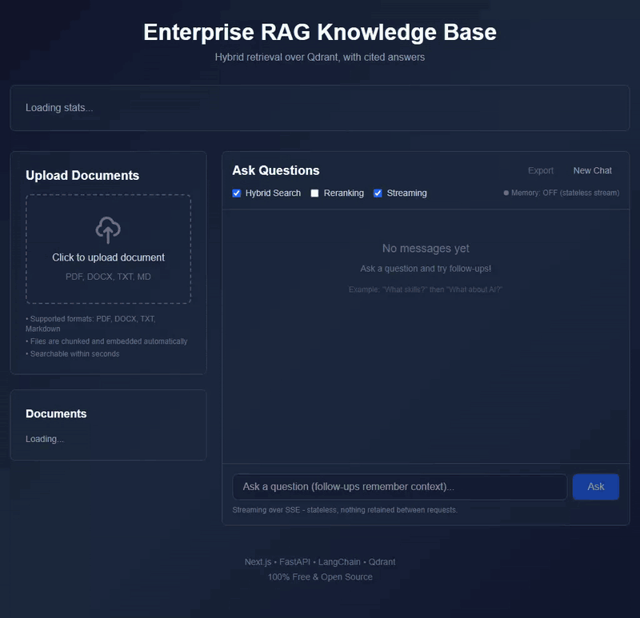
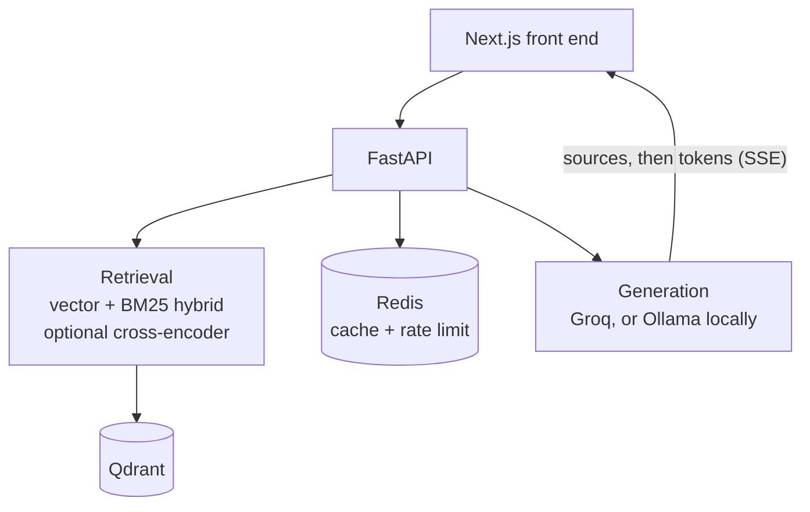

# Enterprise RAG Knowledge Base

FastAPI RAG service on Qdrant: vector and BM25 hybrid retrieval, SSE streaming and an OpenAI-compatible endpoint.



*Recorded on a local stack: Qdrant in Docker, this repo's backend and front end, and qwen3:14b served by Ollama. Three short made-up handbook files, about 14 chunks. The two answer stretches are shown at half speed, marked on screen. Sources are listed per chunk, so one file can appear twice in a citation list, and the dates in the document list read month/day/year.*

**Proof:** hit@1 of 85% vector and 90% hybrid on a 20-question eval (hit@3 is 100% for both), plus a regression test that needs no live service (3 passed). The eval ran over a 26-chunk corpus on the deployment that no longer exists, a different corpus from the 14-chunk one in the recording above. The harness is `backend/tests/eval_retrieval.py`, but that 26-chunk corpus is not in this repo, so the figure is a record of that run and a stranger cannot rerun it as it stands (see Tests).

The hosted copy is offline: the free-tier host suspended its services in October 2026. It runs locally in a few commands below, and the recording above is one such run.

## What it is and why

Upload documents (PDF, DOCX, TXT, Markdown), ask questions, get answers with citations. The backend is FastAPI and LangChain over Qdrant, the front end is Next.js. I built it to see where a retrieval pipeline actually fails, so most of this README is about the failures.

## What broke

- **A scoring bug that inverted the ranking.** `hybrid_search` applied `1 / (1 + score)` to a cosine similarity that was already "higher is better", so a 0.82 match scored 0.549 and a 0.12 match scored 0.893. Every test stayed green because they only checked that results came back. The fix uses the cosine score directly, and `backend/tests/test_hybrid_ranking.py` now fails on the original line. I retracted an earlier accuracy series (about 40, 60 and 67.7 percent) because it predated the fix and was never re-measured.
- **A deploy that looked like a slow cold start.** The 512 MB free instance was OOM-killed on import because the default Linux torch wheel is 526.6 MB. The fix was to drop torch from the deployed image: fastembed runs the same all-MiniLM-L6-v2 weights through ONNX Runtime, so the vectors already in Qdrant stayed valid. Measured under a real 512 MB cap: import time about two minutes down to 1.87 seconds, peak memory 438 MiB down to 259 MiB.
- **A retired model.** Groq retired the model this service named in seven places. The key stayed valid and the client still built, so calls failed while the health endpoint said the vector database was connected. The model is now one setting, `GROQ_MODEL`.

The full write-up, including the design decisions, is in [docs/engineering-notes.md](docs/engineering-notes.md).

## Measured results

20 questions over a 26-chunk corpus, run on 2026-08-03 against the then-live deployment with `backend/tests/eval_retrieval.py`:

| hit@k | vector only | hybrid |
|---|---|---|
| k=1 | 85.0% | 90.0% |
| k=3 | 100% | 100% |

Hybrid beat vector by one question out of twenty: a direction, not a settled result. A cached repeat of a query took 0.28 seconds against 2.7 for the first call (curl from my machine, 2026-10-07, network included). Reranking is not measured.

## Architecture



Hybrid retrieval (the default) scores the top 2k vector hits at cosine times 0.7 and adds a flat 0.15 to any chunk BM25 also returns, so BM25 is a keyword-agreement bonus, not a normalised score. Other endpoints: `POST /api/query/stream` (citations arrive before the first token) and `POST /api/v1/chat/completions` (repoint an OpenAI client's `base_url`).

## Run it

You need Docker, Python 3.13+, Node 18+ and Ollama with one model pulled. The local path needs no account and no API key; a Groq key is only for the cloud setup in [docs/reference.md](docs/reference.md). `pip install` pulls torch and the first backend start downloads the all-MiniLM-L6-v2 embedding model, so allow a few minutes.

The commands use the code's default model, `llama3`. The recording used `qwen3:14b`: to match it, pull that model and set `OLLAMA_MODEL=qwen3:14b`, `OLLAMA_REASONING=false` and `OLLAMA_TIMEOUT=300` before starting the backend (step 2 of the reference). Answers from `llama3` will read differently.

```bash
docker run -d --name rag-qdrant -p 6333:6333 qdrant/qdrant && ollama pull llama3
cd backend && python -m venv venv && source venv/bin/activate && pip install -r requirements.txt   # Windows Git Bash: venv/Scripts/activate
QDRANT_URL=http://localhost:6333 python -m app.main            # http://localhost:8001, docs at /docs
cd ../frontend && npm install && echo "NEXT_PUBLIC_API_URL=http://localhost:8001/api" > .env.local && npm run dev
```

Sample documents are in [`docs/sample-corpus/`](docs/sample-corpus/). Full steps, API examples, environment variables and deployment are in [docs/reference.md](docs/reference.md).

## Tests

```bash
cd backend && pytest tests/test_hybrid_ranking.py     # 3 passed, no live service
python tests/eval_retrieval.py --base-url http://localhost:8001/api
```

The other files in `backend/tests/` are scripts run by hand against a local backend. There is no CI test run.

## Limits and not done

- Cross-encoder reranking works locally only, and I have not measured it. HyDE and multi-query exist as library functions, not API routes, and are not evaluated.
- The eval is 20 questions on a small corpus: a regression check, not a benchmark. The corpus must be re-ingested to reproduce it.
- Conversation memory is in-process and lost on restart.
- CORS allows every origin. `GET /api/health` makes a real model call and can stall other requests on a slow local model.
- `docker-compose.yml` predates the move to Qdrant and is unmaintained.
- `DELETE /api/documents/{name}` deletes the chunks but reports `chunks_deleted: 0`.

## Stack

Python 3.13, FastAPI, LangChain, LangGraph, Qdrant, Redis, fastembed or sentence-transformers (all-MiniLM-L6-v2), rank-bm25, Groq, Ollama, Next.js 16, React 19, TypeScript, Tailwind CSS.

## License

MIT, see [LICENSE](LICENSE). By Daniel Alexis Cruz, [dacruz.vercel.app](https://dacruz.vercel.app).
