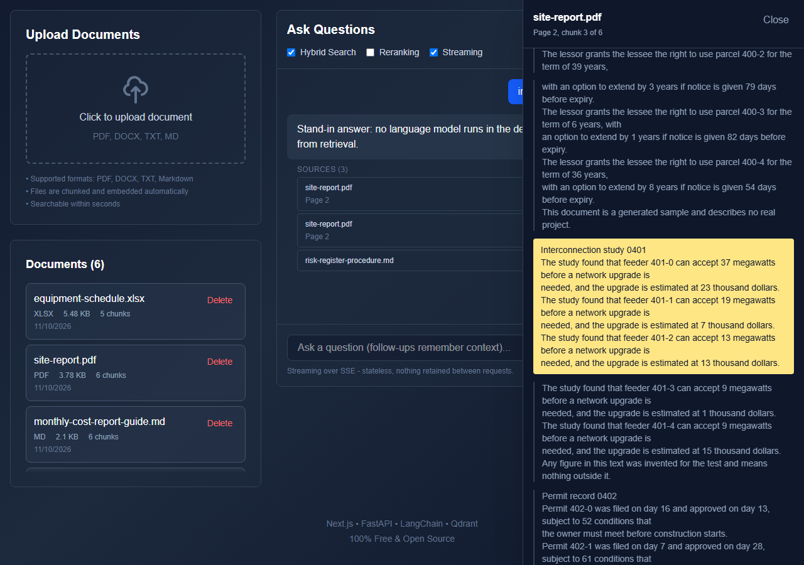

# Reviewer source view

A citation under an answer opens a side panel that shows the cited passage inside its document, with the cited text highlighted and the chunks around it above and below. The panel names the document and says where the passage sits: a page for a PDF, a sheet and cell range for a workbook, a chunk number for everything else.



*Recorded from the real front end against the demo corpus (`backend/eval/demo_server.py`). The answer text is a stand-in because that server calls no language model. The citations are what hybrid retrieval returned.*

## What the API returns

`GET /api/documents/{doc_id}/chunks/{chunk_id}?context=2`

```json
{
  "doc_id": "3f1c...e9",
  "file_name": "site-report.pdf",
  "file_type": "pdf",
  "total_chunks": 6,
  "chunk":  { "chunk_id": 2, "text": "Interconnection study 0401 ...", "page": 2, "location": { "kind": "page", "label": "Page 2" } },
  "before": [ { "chunk_id": 0, "text": "...", "page": 1, "location": { "kind": "page", "label": "Page 1" } },
              { "chunk_id": 1, "text": "...", "page": 1, "location": { "kind": "page", "label": "Page 1" } } ],
  "after":  [ { "chunk_id": 3, "text": "...", "page": 2, "location": { "kind": "page", "label": "Page 2" } },
              { "chunk_id": 4, "text": "...", "page": 3, "location": { "kind": "page", "label": "Page 3" } } ]
}
```

`context` is how many chunks to return on each side, from 0 to 5, default 2. A chunk that is not there, or a document id nobody stored, is a 404. The answer routes (`/api/query`, `/api/query/stream`, the conversation path) now put `doc_id` and `chunk_id` on every source, so the front end can open a citation without a search.

## How a chunk is named

Ingestion writes three values into the metadata of every chunk (`backend/app/services/chunk_identity.py`):

| key | meaning |
|---|---|
| `doc_id` | the SHA-256 of the file's bytes |
| `chunk_seq` | the chunk's position in the whole file, from 0, counted across pages and sheets |
| `doc_chunks_total` | how many chunks the file produced |

`chunk_index` was already there, but the chunker restarts it on every page or sheet, so different chunks of one PDF can share the same chunk_index. `chunk_seq` is the number that names one chunk of a file. The lookup filters Qdrant on `doc_id` and a `chunk_seq` range, so it reads only the neighbours it returns. Two payload indexes (`metadata.doc_id`, `metadata.chunk_seq`) are created on connect, best effort.

The single file upload (`POST /api/ingest`) and the archive workflow ([ingestion.md](ingestion.md)) both write these values. The upload route's response and its random point ids are unchanged.

## Where a passage sits

- **PDF.** The loader already keeps the page: it makes one document per page and writes `page` into the metadata. Nothing had to be added at ingestion, so the panel reads `page`.
- **Workbook.** The loader writes `location` (for example `Schedule!A2:D26`), which the panel shows as it is.
- **Word, text and Markdown.** The loader keeps no position, so the panel says `Chunk 4 of 7`.

## Scope

The lookup reads the one collection the other routes read (`QDRANT_COLLECTION`). This repo has no tenants or accounts, so there is no tenant filter to apply; a deployment that adds one would add the same filter to `VectorStoreService.get_chunk_window`.

## What it does not do

- Chunks ingested before this change have no `doc_id` or `chunk_id`. Their citations still show but are not clickable. Uploading the file again gives it ids.
- The highlight is the whole cited chunk, not the sentence that supports the answer. A chunk is up to 500 characters.
- Neighbouring chunks overlap by the chunker's 50 characters, so the text at a boundary appears in both.
- It shows text, not the PDF page as an image, and it cannot jump to a position inside a Word file.
- A file uploaded twice keeps two copies of its chunks under the same ids (the upload route does not replace chunks). The lookup returns one copy of each.
- Documents that came in through an archive are named by their path inside the zip. The file list's delete button works from files on disk, so it cannot delete those.
- No sign-in or per-user access. Anyone who can reach the API can open any stored chunk.

## Tests

```bash
cd backend && pip install -r requirements-ci.txt
python -m pytest tests/test_source_view.py            # identity, the lookup, the route, the citations
cd ../frontend && npm ci && npx playwright install chromium
E2E_PYTHON=python npx playwright test                 # a real browser against the real front end and the demo API
```

The Playwright test asks a question on the demo corpus, clicks a citation and checks that the highlighted text is the cited chunk: equal to what the API returns for that citation and contained in the document file on disk. It also opens every citation of one answer, checks a PDF page and a workbook range, and checks that Escape closes the panel and returns focus to the citation.

`python eval/mutation_check.py --only-ingest` breaks the lookup (wrong document, window one chunk too wide, neighbours kept for a missing chunk, copies listed twice, ids ignored) and the identity code, one change at a time, and requires a failing test for each.
